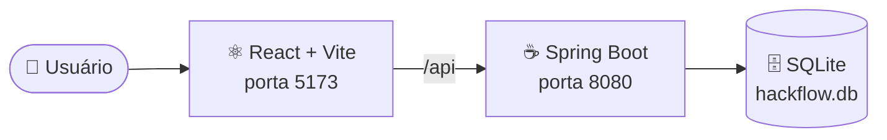
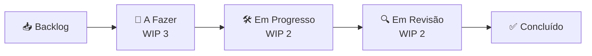

<p align="center">
  
</p>

<p align="center">
  
  
  
  
  
</p>

<p align="center">
  
  
  
</p>

<p align="center">
  <a href="#-sobre">Sobre</a> ·
  <a href="#-funcionalidades">Funcionalidades</a> ·
  <a href="#-como-funciona">Como funciona</a> ·
  <a href="#️-rodando-na-sua-máquina">Rodar</a> ·
  <a href="#️-roadmap">Roadmap</a> ·
  <a href="#-equipe">Equipe</a>
</p>

---

## 📌 Sobre

O **HackFlow** nasceu para o 1º Hackathon do curso de Ciência da Computação do IFPR, Campus Pinhais. Hoje, inscrição, submissão, avaliação e divulgação dos resultados dependem de planilhas, e-mail e WhatsApp. O sistema junta tudo em um lugar só.

> [!NOTE]
> Projeto desenvolvido na disciplina de **Engenharia de Software I**, com a comissão organizadora do evento como cliente.

<table>
  <tr>
    <td>🔁 <b>Antes</b><br>Inscrições duplicadas e dados desencontrados</td>
    <td>📢 <b>Antes</b><br>Avisos espalhados em vários canais</td>
    <td>🐢 <b>Antes</b><br>Avaliação em papel e apuração lenta</td>
  </tr>
  <tr>
    <td>✅ <b>Agora</b><br>Cadastro validado, e-mail único</td>
    <td>✅ <b>Agora</b><br>Central de avisos única</td>
    <td>✅ <b>Agora</b><br>Notas por critério e ranking automático</td>
  </tr>
</table>

## ✨ Funcionalidades

| | | |
|:---:|:---:|:---:|
| 📝 **Cadastro de equipes**<br><sub>3 a 5 integrantes, e-mail único</sub> | 🔐 **Login seguro**<br><sub>Senha com BCrypt e sessão por cookie</sub> | 📦 **Submissão de projeto**<br><sub>Link https e descrição</sub> |
| 🧑‍⚖️ **Avaliação por critério**<br><sub>Inovação, execução e apresentação</sub> | 🏆 **Placar público**<br><sub>Ranking calculado automaticamente</sub> | 📣 **Central de avisos**<br><sub>Com destaque para urgentes</sub> |

## 🖼️ Telas

<!--
Quando tiverem os prints, salve em docs/img/ e remova estas marcas de comentário.

<details>
<summary><b>Clique para ver as telas</b></summary>
<br>

| Cadastro | Painel | Placar |
|:---:|:---:|:---:|
|  |  |  |

</details>
-->

🎨 [Protótipo no Figma](https://www.figma.com/proto/QS1GKDNAEhnb1yGT2AE05r/HackFlow-%E2%80%93-IFPR-Campus-Pinhais?node-id=1-2&p=f&t=KCOmZhu1FK5gHDVr-1&scaling=min-zoom&content-scaling=fixed&page-id=0%3A1)

## 🧭 Como funciona



## ⚙️ Rodando na sua máquina

**Você precisa de:** JDK 21 · Maven 3.9+ · Node.js LTS · Git

```bash
git clone https://github.com/enzolfg/projeto-hackathonifpr.git
cd projeto-hackathonifpr
```

<table>
<tr>
<th>🖥️ Terminal 1: API</th>
<th>🌐 Terminal 2: Site</th>
</tr>
<tr>
<td>

```bash
cd hackflow-backend
mvn spring-boot:run
```

</td>
<td>

```bash
cd hackflow-frontend
npm install
npm run dev
```

</td>
</tr>
</table>

Depois abra **http://localhost:5173** 🎉

> [!TIP]
> O banco `hackflow.db` é criado vazio na primeira execução. Para recomeçar do zero, pare a API e apague o arquivo.

> [!WARNING]
> Ligue a **API antes** do site. Sem ela, as telas mostram "Não foi possível conectar ao servidor".

## 🧰 Tecnologias

| Camada | Tecnologias |
|---|---|
| 🎨 Interface | React, Vite |
| ⚙️ API | Java 21, Spring Boot 3.5, JDBC (`JdbcTemplate`) |
| 🗄️ Dados | SQLite |
| 🔒 Segurança | BCrypt, cookie HttpOnly + SameSite=Strict |

## 📂 Estrutura

```
projeto-hackathonifpr/
├── 📁 hackflow-backend/     API REST (Spring Boot)
├── 📁 hackflow-frontend/    Interface web (React + Vite)
├── 📁 docs/                 Escopo, kickoff e imagens
└── 📄 README.md
```

## 🔐 Segurança

| Item | Situação |
|---|:---:|
| Senhas com hash BCrypt | ✅ |
| Cookie HttpOnly + SameSite=Strict | ✅ |
| Limite de 5 tentativas de login em 15 min | ✅ |
| SQL sempre parametrizado | ✅ |
| Exigir login e papéis (jurado, comissão) nas rotas de escrita | 🔜 |
| HTTPS e recuperação de senha | 🔜 |

## 🗺️ Roadmap

- [x] Kickoff e definição do problema
- [x] Escopo inicial (Sprint 0)
- [x] Protótipo de interface
- [x] API com cadastro, login, projetos, notas e avisos
- [x] Front-end integrado à API
- [x] Sprint 2 concluída
- [ ] Papéis de acesso (participante, jurado, comissão)
- [ ] Validação de inscrição por CPF
- [ ] Deploy para uso real no evento

## 🎯 Contexto do projeto

<details>
<summary><b>👤 Stakeholder</b></summary>
<br>

**Comissão organizadora do Hackathon**: uma professora, um monitor da disciplina de ESI e dois representantes do projeto de extensão Azure DevOps do IFPR. Atua como cliente do sistema, mas não tem formação técnica nem tempo para desenvolver ferramentas próprias.

</details>

<details>
<summary><b>⚠️ Restrições</b></summary>
<br>

| Restrição | Detalhe |
|---|---|
| 💰 Orçamento | Zero para ferramentas pagas |
| ⏳ Prazo | Funcional até a Semana 19, uso real na Semana 20 |
| 🧩 Simplicidade | A comissão tem pouco tempo para aprender o sistema |
| 🔒 LGPD | Dados pessoais tratados com cuidado |

</details>

<details>
<summary><b>🚫 Fora do escopo</b></summary>
<br>

- Pagamentos
- Chat interno
- App mobile nativo
- Notificações push
- Integração com redes sociais

</details>

## 🔄 Processo



Kanban no **GitHub Projects**, com alinhamento às segundas e quintas e revisão do quadro às sextas.

## 📚 Documentação

| Documento | Descrição |
|---|---|
| [Índice da documentação](docs/README.md) | Todos os documentos do projeto |
| [Kickoff](docs/01-planejamento/kickoff-definicao-problema.pdf) | Problema e stakeholder |
| [Escopo inicial](docs/01-planejamento/escopo-inicial-sprint0.pdf) | Escopo da Sprint 0 |
| [README da API](hackflow-backend/README.md) | Endpoints e detalhes do back-end |

## 👥 Equipe

| Integrante |
|---|
| Enzo Leonardo Ferreira Gonçalves |
| Evellin Silva Sebastião |
| Henrique Gabriel da Silva |
| Kauã Vinicius Silva Alves |

---

<p align="center">
  <sub>Engenharia de Software I · Ciência da Computação · IFPR Campus Pinhais<br>Profa. Lauriana Paludo · Turma BCC.2</sub>
</p>
